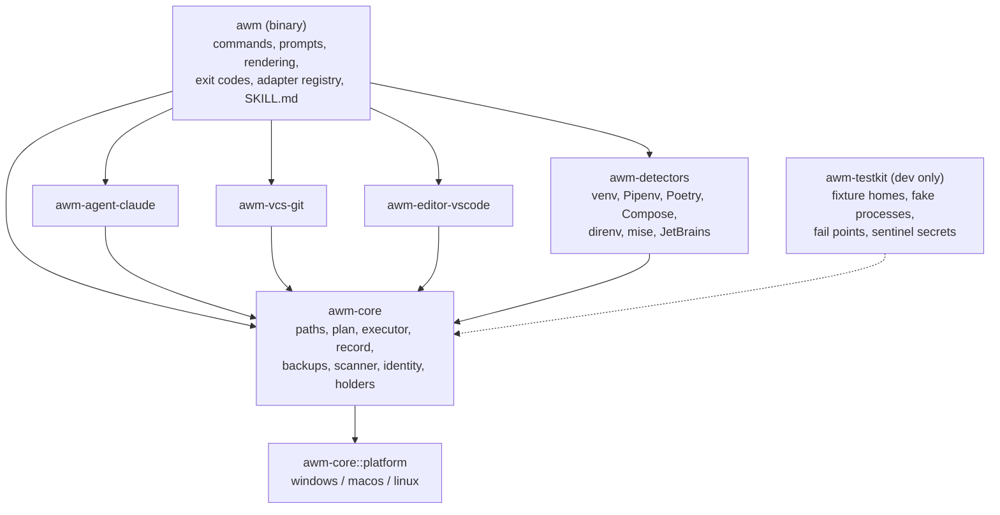
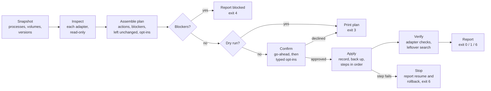
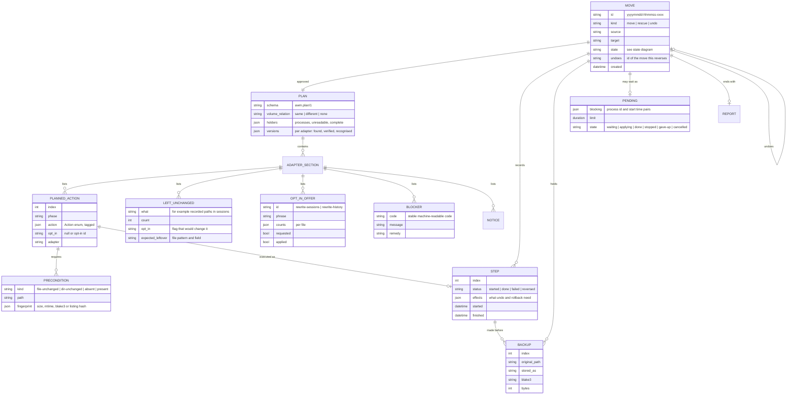
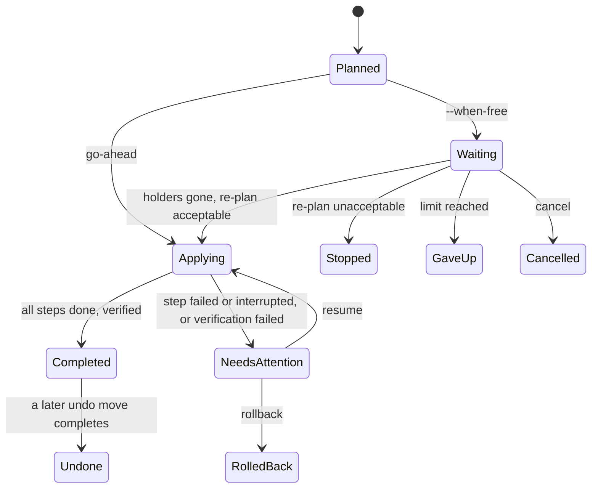

# agent-workspace-mover Design

## Summary

**Adapters describe, the core acts.** Every adapter (Claude Code, git, VS Code, and the report-only detectors) inspects the machine read-only and returns what it found as data: actions drawn from a small closed set, the things it leaves unchanged, the opt-ins it offers, blockers and notices. The core merges these into one **plan**. The plan is what a dry run prints, what the user approves, what the finish-later waiter re-checks, and what the executor carries out. So a dry run can't differ from the real run (REQ-4).

**The executor works through a write-ahead record.** It records each step before carrying it out, backs up content before changing it, and moves the workspace folder first, because on Windows that's the step most likely to fail. Every action type knows how to tell whether it has already happened, and how to reverse itself by structure, not by restoring whole files. That one mechanism serves resume, rollback and undo. Backups remain the last resort.

**Two safety rules are enforced by Rust's type system, not by convention.** An opt-in can only go ahead with a confirmation value that only the terminal prompt can create (REQ-8). Text read from agent data has a type that can't be printed (REQ-26).

## Architecture

### Crates

A Cargo workspace whose core knows nothing about any particular agent, version-control system or editor (24.0.1).



- **`awm-core`** holds everything common to all adapters: the path model, plan assembly, the executor, move records and backups, the JSONL scanner, workspace identity, finding what holds a folder, leftover search, and the `Adapter` and `Platform` traits.
- **Adapter crates** depend only on `awm-core`. Each one implements `Adapter`. Adding an agent means adding a crate and one line to the registry in `awm` (24.1).
- **`awm`** is the binary. It parses commands, builds the registry, runs prompts, renders human-readable and JSON output, maps outcomes to exit codes, and embeds `SKILL.md`.
- **`awm-testkit`** builds fixture home folders and fake processes, and provides test helpers. It's never shipped.

### What a run goes through



Mutating commands (`move`, `rescue`, `undo`, `resume`, `rollback`, `backups prune`, and the waiter applying a move) take one machine-wide lock, `File::lock` on `<state>/lock`, for their whole run. Read-only commands (`plan`, `--dry-run`, `scan`, `status`, `history`) take no lock and are safe while anything else runs (4.0.3, 18.0.3).

### Order of steps

Actions belong to phases, and the executor runs phases in this order:

1. **Recheck.** Re-snapshot the processes and re-check every action's preconditions (see "Key design decisions", 6). Anything changed since planning stops the run before any change.
2. **Back up** every file a later step will edit, and verify each copy (12.0.1).
3. **Move the workspace folder** (1.0.3, 1.0.4). It goes first because, on Windows, it's the step most likely to fail: a sharing violation means something is holding the folder. Failing here leaves nothing changed.
4. **Repair version control** (REQ-9).
5. **Carry agent data**: session folders and memory (REQ-6).
6. **Carry settings**: `~/.claude.json` (REQ-7).
7. **Carry editor state** (REQ-21).
8. **Update paths inside the workspace**, the files the user selected (REQ-10), at their new location.
9. **Opt-ins**, each only with its typed confirmation (REQ-8).
10. **Verify and search for leftovers** (REQ-16).

A rescue (REQ-15) is the same plan without step 3. An undo (REQ-14) is a plan built from a past move's record (see "Key design decisions", 5).

### Platform layer

`awm-core::platform` is the only code that calls OS-specific interfaces. It has one module per OS behind a `Platform` trait (see "Interfaces"), and tests can replace the implementation.

| Need | Windows | macOS | Linux |
|---|---|---|---|
| Processes, parents, working folders | `sysinfo` (reads the process environment block, including 32-bit processes) | `sysinfo` | `sysinfo` |
| Files held open | Restart Manager | `libproc` through `libc`, falling back to `lsof` | `/proc/<pid>/fd` |
| Volume identity | volume serial number | `st_dev` | `st_dev` |
| Case sensitivity | case-insensitive | asked per volume (`pathconf _PC_CASE_SENSITIVE`) | case-sensitive |
| Files only the user can read | protected access-control list for the current user's account | `0600`/`0700` | `0600`/`0700` |
| Folder creation time | `SetFileTime` | `setattrlist` | not applicable (VS Code uses the inode) |
| Finish-later waiter | Task Scheduler task, falling back to a detached process | double fork + `setsid` | double fork + `setsid` |

## Key design decisions

### 1. Adapters return data, and the core performs a closed set of actions
**What:** Adapters never change anything. `Adapter::inspect` returns a `Contribution` (see "Interfaces") whose actions come from one closed `Action` enum: move a tree, merge a folder, edit a JSON file, edit a JSON row in SQLite, splice a JSONL field, replace text, run an external tool. The executor is the only code that changes the machine.
**Why:** Backups, the record, preconditions, resume, rollback, undo, dry-run parity and fault injection are each written once, for every adapter (REQ-12, REQ-13, REQ-14, 4.0.2, 24.0.1). An adapter author can't forget to back something up.
**Alternatives considered:** each adapter applying its own changes through callbacks. That's simpler to start with, but every adapter would then have to reimplement recording, backups and reversal correctly. It's also what makes the reference script hard to undo.

### 2. One plan for dry run and real run
**What:** `plan` and `--dry-run` build exactly the same `Plan` as `move` does, then stop before confirmation. The real run applies the `Plan` it printed, re-checked by its preconditions. Counts are computed while inspecting, not while applying.
**Why:** It makes 4.0.2 true by construction, so 4.1 becomes a regression test rather than a hope. The finish-later waiter compares a fresh plan with the approved one in the same structured form (19.0.3).

### 3. The workspace folder moves first
**What:** See "Order of steps". Before planning, the tool compares the volume ids of the source's parent and the target's parent to decide between a rename and a copy.
**Why:**
- Locks are the commonest cause of failure on Windows, and putting the folder move first means a locked folder causes a clean "blocked, nothing changed" result (exit 4).
- On Windows the rename is also the only definitive lock test. Finding holders in advance is best effort (see "Key design decisions", 9).

### 4. A write-ahead record, and steps that can tell whether they've happened
**What:** Each move gets a folder under the tool's state folder (see "Data model"). Before carrying out a step, the executor writes `steps/NNNN.json` with status `started`, flushed to disk. After the step it rewrites the file as `done`, with the step's *effects*: what undo will need, such as pre-existing entries, spliced offsets and values written. Every action type also implements a **probe** that inspects the machine and answers *not started*, *done* or *partial*. For a move, for example: source present and target absent; target present and source absent; or both present. On `resume`, a step recorded as `started` is probed and then completed, or skipped if it's done. `rollback` probes it, then reverses it.
**Why:**
- 12.0.2 and 13.1 require that a kill at any step boundary is recoverable.
- A record entry alone can't say whether the effect happened, if the process died between doing it and recording it. The probe can.

**Alternatives considered:** a single journal file with appended entries. That's harder to write atomically on Windows, and harder to read by hand.

### 5. Undo and rollback reverse by structure, and backups are the last resort
**What:** Every action records enough in its effects to reverse itself without restoring a whole file:

| Action | Reversed by | Checked before reversing |
|---|---|---|
| Move a tree | moving it back | the source path is free |
| Merge a folder | merging back every entry, except those already at the destination before the move (recorded) | no name at the old location is taken |
| Rename a JSON key | renaming it back, with the value as it is now | the new key exists, and the old one is absent |
| Replace a JSON string | replacing it back | the current value equals the value written |
| Splice JSONL fields (opt-in) | splicing the recorded original values back at the recorded line numbers | the bytes at each recorded span equal the value written |
| Replace text in a workspace file | replacing it back at the recorded offsets | as for splicing |
| Run a tool (git repair) | its declared inverse, run after the reverse move | — |
| Re-key VS Code storage | re-keying back to the id for the source path | — |

A check that fails makes that file a blocker (14.0.3), and the report offers its backup.
**Why:**
- Agents keep writing after a move. A session continued after a move appends lines, and Claude Code rewrites `~/.claude.json` constantly. Restoring a backup would lose that new data, while reversing by structure carries it back (14.2).
- Undo still works after `backups prune`, except where a check fails (14.0.4).

**Alternatives considered:** restoring backups, as the reference script would. That's simple, but it loses data written after the move, which breaks 14.0.3.

### 6. Every action carries preconditions
**What:** Each action lists what must still be true for it to be safe, captured while planning:
- a file's size, modification time and `blake3` hash, for files to be edited
- a folder's listing (names, sizes, modification times), for merges
- "the path is absent", for targets

The executor checks them all at the recheck step, and again immediately before each action. JSON and SQLite edits also compare-and-swap. They read the file, apply the edit, write a temporary file, then confirm the original is unchanged before replacing it (7.0.5, 7.5).
**Why:** It catches a change between planning and applying, from the user, a sync tool or an agent that started meanwhile, before it can be overwritten. The same check tells the finish-later waiter that its approved plan has gone stale.

### 7. Claude Code project folders are matched by the paths recorded inside them
**What:**
1. Candidates are folders in Claude Code's `projects/` whose name equals `encode(source)`, or starts with `encode(source) + "-"`, ignoring case.
2. For each candidate, the adapter streams the top-level `cwd` values from its transcripts (read only, with the scanner).
3. It keeps those that encode exactly to the candidate's name: that's the folder's real path.
4. A candidate matches only if its real path is the source or under it.
5. A candidate with no transcripts matches only on the exact name.
6. A candidate whose `cwd` values give more than one real path is ambiguous.

Both of the last two are left alone and listed (6.0.3, 6.0.4).

`encode` here means Claude Code's whole naming rule, including how it shortens names over 200 characters: the first 200 characters, then `-` and a base-36 hash of the path ([facts.md](facts.md), F-2). Because of that, candidate prefixes are compared on at most their first 200 characters. A transcript can record both an old and a new path once a moved session has been resumed (facts.md, F-1). Only the `cwd` values that encode to the folder's own name count, so such a folder isn't ambiguous.
**Why:** The encoding turns every character other than a letter or digit into `-`, so information is lost. The reference script's prefix match would also catch `website-old` (requirements.md, section 3). Paths recorded inside the transcripts are the only reliable source.

### 8. Formats are recognised by shape, and versions by declared range
**What:** Each adapter declares two version sets:
- **Verified**, with OSes: Claude Code 2.1.309 on Windows 11.
- **Recognised**: proposed as the same minor version, Claude Code `>=2.1.0, <2.2.0`.

A version that's recognised but not verified produces a notice. A version outside the recognised range blocks the adapter's changes unless `--allow-unverified claude-code` is given, which the report records (24.0.3).

The adapter also checks the shape of each thing it depends on:
- a `projects` object in `~/.claude.json`, keyed by paths with forward slashes
- `cwd` as a string at the top level of each transcript line
- the project-folder layout

A line it can't parse blocks Claude Code's changes (24.3), with one exception: an unterminated final line, which is what a session killed mid-write leaves. That's moved unchanged and reported as a notice, because blocking every move after a crash would be worse than the risk.
**Why:** Claude Code releases often. An exact-version gate would make the tool refuse almost every week, while no gate at all would guess with irreplaceable data.

### 9. Finding holders: cheap checks first, the rename as the final test, full diagnosis on failure
**What:** While planning, the tool:
1. checks every process's working folder (fast, from one process snapshot)
2. on Windows, asks the Restart Manager about files under the source, within a 3-second time budget, returning `complete: false` if the budget runs out
3. walks its own ancestors to recognise the session it runs in (20.0.3): any ancestor that's a running agent process, or whose working folder is under the source

If the Windows rename then fails with a sharing violation or access denied, the tool runs the Restart Manager over every file with no time budget, names the holders, and exits 4 with nothing changed.

The Restart Manager takes **at most 65,535 files per session**. At 65,536 it silently reports no holders, and above that it crashes the calling process (facts.md, F-8). So the platform layer:
- registers files in sessions of at most 50,000, with that limit kept as a tested constant rather than left to callers
- registers each session's files in one call, since many small calls are slower
- treats any Restart Manager error as `complete: false`, never as "nothing holds these files"

On this machine the 3-second budget covers about 40,000 files.
**Why:** Asking the Restart Manager about 100,000 files takes longer than REQ-28 allows (about 5 seconds per 65,000 files measured). The rename is atomic: it either succeeds or fails cleanly. So the plan says what it found, and says when its search was incomplete (20.0.4), rather than paying the full cost on every run.

### 10. Opt-in confirmations exist only as a type the terminal prompt creates
**What:** `awm-core` defines `TypedConfirmation` with a private constructor, reachable only through `prompt::confirm_phrase(&Terminal, phrase)` in `awm`. A `Terminal` can only be opened when both standard input and output are terminals, and it reads the phrase directly from the terminal. `Executor::apply` takes `&[TypedConfirmation]`, and an opt-in action is skipped unless a matching confirmation is present.
**Why:**
- It makes 8.0.4 and 8.0.5 hold at compile time. No config file, environment variable, flag, piped input, `--yes` or finish-later waiter can produce a confirmation, because none of them can call the constructor.
- 8.5 becomes partly a code fact: there's no config file at all in v1 (see "Key design decisions", 14).

### 11. Text from agent data has a type that can't be printed
**What:** Bytes read from agent data, editor data or process files are wrapped in `AgentBytes`. It implements neither `Display` nor `Serialize`, and its `Debug` prints `<redacted, N bytes>`. The plan, report, logger and JSON output accept only paths, field names, counts, ids and the tool's own messages. Masked match previews (10.0.3) are produced by one function with its own tests: up to 40 characters either side of the match, with token-like runs replaced by `****`.
**Why:** REQ-26 becomes something the compiler checks, rather than a review checklist. 26.2's sentinel test then guards the one deliberate exception.

### 12. Cross-volume moves copy to a hidden sibling, then rename into place
**What:**
1. Copy the source to `<target parent>/.awm-partial-<move id>`, preserving modification times and, where the OS allows, creation times (21.0.7).
2. Verify every file's size and `blake3` hash against the source.
3. Rename the copy to the target, which is atomic, since it's on the same volume as the target.
4. Delete the source.

The probe tells the states apart: partial copy present, target present with the source intact, or target present with the source partly deleted.
**Why:** The target never exists half-copied, so 2.0.2's "target exists" check stays meaningful. An interrupted copy resumes or is discarded without touching the source (1.4).

### 13. VS Code storage is re-keyed after the move, and only once the formula is proven
**What:** Before planning any re-key, the VS Code adapter recomputes the id of every existing workspace storage folder under the source from its `workspace.json` folder and that folder's creation time or inode. If any computed id differs from its folder's name, it refuses all re-keying (21.0.5). The re-key action names its destination as computed at apply time, because on Linux the id uses the inode, which a cross-volume copy changes. The adapter resolves the destination after step 3 (21.0.7).

The adapter also rewrites, as structured JSON, the string values in each re-keyed workspace's own `state.vscdb` that are paths or file URIs under the source. That includes JSON nested inside JSON strings, which is how VS Code stores open editors. Rows whose values aren't JSON are left alone and reported. This is what lets 21.1's "open editors' layout" come back.

What facts.md (F-6, F-7) found, for VS Code 1.143:
- **The formula** uses the URI's own `fsPath`, with a lowercase drive letter on Windows. It matched every live folder tested.
- **A row holding a bare path or URI** rather than JSON, such as `debug.selectedroot`, is rewritten as a single path value, when the whole value is a path under the source.
- **The GitHub extension's `vscode.github` row** holds a cache of branch-protection rules keyed `branchProtection:<folder URI>`, which the extension rebuilds. The adapter leaves it alone, and lists it as an expected leftover ("Key design decisions", 17).
- **Multi-root workspaces** (`workspace.json` naming a `.code-workspace` file) are outside REQ-21. A `.code-workspace` file under the source is reported as detected but not handled.
**Why:** The formula is a VS Code implementation detail. Proving it against the machine's own data costs one hash per folder, and removes the risk of moving state somewhere VS Code will never look.

### 14. No config file in v1
**What:** Every behaviour is a command-line flag, including the finish-later waiting limit (`--wait-limit`, default `24h`). File locations come from the standard environment variables (`HOME`/`USERPROFILE`, `APPDATA`, `LOCALAPPDATA`, `XDG_*`, `CLAUDE_CONFIG_DIR`), read in one place (`Locations::from_env`). When `CLAUDE_CONFIG_DIR` is set, Claude Code's global config is `$CLAUDE_CONFIG_DIR/.claude.json`, not `~/.claude.json` (facts.md, F-3).
**Why:**
- No config file means no config key can ever switch on an opt-in (8.0.5).
- Tests point the tool at fixture homes by setting the same environment variables, with no test-only override needed (6.6).

### 15. Identical files merge, and different files with the same name block
**What:** When merging a folder, if an entry exists on both sides, it isn't a collision when both are folders (they merge recursively) or when they're files with identical content (the source copy is dropped, and the plan lists it). Two different files with the same name are a collision and a blocker (2.0.7).
**Why:** A rescue often follows a hand-made copy, leaving the same files on both sides. Treating identical files as collisions would block every such rescue for no safety gain, since nothing is lost. Dropping a duplicate is deleting what a planned step made redundant (27.0.2).

### 16. Finishing later re-plans, and never applies opt-ins
**What:**
1. `move --when-free` plans and gets the go-ahead in the foreground, then writes `pending/<move id>.json`: the approved plan, the blocking processes (process id plus start time, to survive process-id reuse) and the time limit.
2. It starts the waiter through `Platform::spawn_waiter`. Where that's unavailable (Task Scheduler disabled, and a job that forbids breaking away), it reports that finishing later isn't available, and starts nothing. On Windows, a task that runs as the logged-in user opens a visible console window for a console program, for as long as it runs (facts.md, F-9). So the waiter has to start without a window. How is decided with the owner in TASK-28: a helper binary built for the Windows subsystem, the waiter freeing its console at once (a brief flash), or a logon type that doesn't run on the user's desktop. GitHub's Windows runner forbids breaking away, so the detached fallback checks the job's limits before relying on it.
3. The waiter, `awm __wait <id>`, an internal command, waits for the blocking processes to exit. It uses process handles on Windows, and polls every 2 seconds elsewhere. Because new agent processes may start while it waits, it re-checks for them.
4. Once nothing has blocked for two checks in a row, it takes the lock and plans again without a terminal. It applies the new plan only if the new plan has no blocker and no kind of action the approved plan lacked (19.0.3).
5. It records the outcome where `status` reads it.

The waiter has no `Terminal`, so it can't create a `TypedConfirmation`, and opt-ins can't run (19.0.4).
**Why:** Re-planning catches anything that changed while it waited. Comparing kinds of action rather than counts lets ordinary growth through, such as new sessions to carry, while stopping anything the user never saw.

### 17. Searching for leftovers uses the adapters' own expectations
**What:** Each adapter names the roots to search (Claude Code's data folder and `~/.claude.json`; VS Code's user folder) and lists the expected leftovers: each left-unchanged item, with its file pattern, field and count. After verification, the core searches the roots for every form of the source path, with the same search engine as REQ-10. It reports counts per file, plus the names of the JSON fields where matches sit. Anything not covered by an expected leftover is a warning (16.0.3), which gives exit 1.
**Why:** The real move found prompt history and VS Code state only by searching. Expectations stop the default move's deliberate leftovers from hiding a truly unknown one.

## Data model

### Plans and records



### A move's states



`Completed` with warnings, or with "couldn't do" items, is still `Completed`. The distinction is in the report and the exit code (1). A move found as `Applying` when the lock is taken was interrupted, and is treated as `NeedsAttention` (13.0.1).

### On disk

```
<state>/                         %LOCALAPPDATA%\agent-workspace-mover, ~/Library/Application Support/agent-workspace-mover,
│                                or $XDG_STATE_HOME/agent-workspace-mover (0700 / user-only access-control list)
├── lock                         held by mutating runs
├── log/awm-YYYYMMDD.log         redacted log (REQ-26)
├── moves/<move id>/
│   ├── move.json                id, kind, source, target, state, undoes
│   ├── plan.json                the approved plan
│   ├── steps/0001.json …        write-ahead step records
│   ├── backups/0001-<name> …    content backups (0600 / user-only)
│   └── report.json              final report
└── pending/<move id>.json       finish-later state, while waiting
```

Each JSON file is written atomically: write a temporary file, flush it, then rename it over the old one.

## Interfaces

### Adapter trait (`awm-core`)

```rust
/// One agent, version-control system, editor or detector's knowledge of the machine.
/// Implementations never change anything; they describe what should change.
pub trait Adapter: Send + Sync {
    /// Id, kind, and the versions and OSes this adapter is verified against and recognises.
    fn info(&self) -> AdapterInfo;

    /// Reads the machine and contributes to the plan for `request` (move, rescue or undo).
    fn inspect(&self, cx: &InspectContext, request: &MoveRequest) -> Result<Contribution, AdapterError>;

    /// Resolves a destination the adapter deferred to apply time (VS Code's storage ids).
    fn resolve(&self, cx: &InspectContext, key: &DeferredKey) -> Result<PathBuf, AdapterError> {
        Err(AdapterError::NothingDeferred)
    }

    /// Checks the applied result: for example, the transcript count at the target.
    fn verify(&self, cx: &InspectContext, request: &MoveRequest) -> Vec<VerifyCheck>;

    /// Roots the leftover search should cover, and the leftovers this plan expects there.
    fn leftovers(&self, cx: &InspectContext, plan: &AdapterSection) -> LeftoverSpec;

    /// Running processes of this adapter's program, which block changes to its data.
    fn running(&self, processes: &ProcessSnapshot) -> Vec<ProcessRef> { Vec::new() }

    /// Data whose recorded folder no longer exists (`scan`, `rescue <current>`).
    fn orphans(&self, cx: &InspectContext) -> Result<Vec<Orphan>, AdapterError> { Ok(Vec::new()) }

    /// Identity of a workspace, for version-control adapters.
    fn identity(&self, cx: &InspectContext, folder: &Path) -> Option<Identity> { None }
}

/// What one adapter adds to a plan.
pub struct Contribution {
    pub actions: Vec<PlannedAction>,
    pub left_unchanged: Vec<LeftUnchanged>,
    pub opt_ins: Vec<OptInOffer>,
    pub blockers: Vec<Blocker>,
    pub notices: Vec<Notice>,
    pub counts: Vec<Count>, // for example ("sessions listed by the picker", 2), ("reachable only by id", 1)
}

/// The closed set of changes the executor knows how to make, record, probe and reverse.
pub enum Action {
    MoveTree { from: PathBuf, to: PathBuf },
    MergeDir { from: PathBuf, to: Destination },
    EditJsonFile { file: PathBuf, edits: Vec<JsonEdit> },
    EditSqliteJsonRow { db: PathBuf, table: String, key: String, edits: Vec<JsonEdit> },
    SpliceJsonlField { file: PathBuf, field: String, mapping: PathMapping },
    ReplaceInText { file: PathBuf, mapping: PathMapping, matches: Vec<TextMatch> },
    RunTool { program: String, args: Vec<OsString>, cwd: PathBuf, inverse: Option<Box<Action>> },
}

pub enum Destination { Path(PathBuf), Deferred { adapter: AdapterId, key: DeferredKey } }

pub enum JsonEdit {
    RenameKey { object: JsonPointer, from: String, to: String },
    ReplaceString { at: JsonPointer, from: String, to: String },
    /// String values (recursing into JSON held in strings) that are paths or URIs under the mapping's source.
    RewritePathStrings { at: JsonPointer, mapping: PathMapping },
}
```

### Path model (`awm-core::paths`)

```rust
/// Source and target, with every form in which tools record them (5.0.1).
pub struct PathMapping { /* source, target, case rule, forms */ }

pub enum PathForm { Native, ForwardSlash, JsonEscaped, PosixDrive, FileUri, FileUriPercentEncoded }

impl PathMapping {
    pub fn new(source: &Path, target: &Path, case: CaseRule) -> Self;
    /// Every occurrence in `text` at a whole-segment boundary (5.0.3), with its form.
    pub fn find(&self, text: &[u8]) -> Vec<PathMatch>;
    /// The replacement for one match, in the same form and drive-letter case style (5.0.4).
    pub fn rewrite(&self, m: &PathMatch) -> Vec<u8>;
    /// Whether `path` is the source or under it.
    pub fn covers(&self, path: &Path) -> Option<RelativePath>;
}
```

A match ends at a segment boundary: the end of the text, a separator in that form, `\\` (JSON-escaped), a quote, whitespace, or one of `<>|:;,)]}`. So `repo-old` and `repo.bak` never match `repo`.

### Platform trait (`awm-core::platform`)

```rust
pub trait Platform: Send + Sync {
    fn processes(&self) -> ProcessSnapshot; // pid, start time, name, exe, args, parent, cwd (None if unreadable)
    fn open_file_holders(&self, files: &[PathBuf], budget: Option<Duration>) -> HolderScan; // holders, complete
    fn volume_id(&self, path: &Path) -> io::Result<VolumeId>;
    fn case_rule(&self, path: &Path) -> CaseRule;
    fn restrict_to_user(&self, path: &Path) -> io::Result<()>;
    fn creation_time(&self, path: &Path) -> io::Result<Option<SystemTime>>;
    fn set_creation_time(&self, path: &Path, time: SystemTime) -> io::Result<()>;
    fn spawn_waiter(&self, exe: &Path, move_id: &str) -> Result<(), WaiterUnavailable>;
    fn wait_for_exit(&self, processes: &[ProcessRef], timeout: Duration) -> WaitOutcome;
}
```

### Commands

| Command | Does | Changes anything |
|---|---|---|
| `move <source> <target>` | Checks, plans, confirms and moves (REQ-1) | yes |
| `plan <source> <target>`, `move --dry-run` | Plans only (REQ-4) | no |
| `rescue [<old>] <current>` | Reattaches orphaned data (REQ-15) | yes |
| `undo [<move id>]` | Reverses a move (REQ-14) | yes |
| `resume`, `rollback` | Finishes or reverses an interrupted move (REQ-13) | yes |
| `scan [--search <folder…>]` | Lists orphaned data (REQ-18) | no |
| `status`, `cancel` | Shows or stops a waiting move (REQ-19) | `cancel` stops a waiter |
| `history`, `backups list`, `backups prune <move id> \| --older-than <age>` | Past moves and their backups (12.0.5, 12.0.6) | `prune` only |
| `skill install` | Installs `SKILL.md` into `<Claude Code data folder>/skills/agent-workspace-mover/` (REQ-23) | yes, after go-ahead |

Flags: `--dry-run`, `--yes`, `--json`, `--fresh-settings`, `--rewrite-sessions`, `--rewrite-history`, `--update-paths <file…>`, `--include-ignored`, `--when-free`, `--wait-limit <duration>`, `--allow-unverified <adapter>`, `--search <folder…>`.

The two opt-in flags only *request* an opt-in. It applies only after its phrase is typed at a terminal (see "Key design decisions", 10). With `--json`, standard output isn't a terminal, so a run with `--json` can't apply opt-ins, and its report gives the command to run instead.

### Exit codes (22.0.2)

| Code | Meaning |
|---|---|
| 0 | Succeeded; everything planned was done and verified |
| 1 | Succeeded with warnings: "couldn't do" items, unexpected leftovers or failed checks that aren't fatal. Expected left-unchanged items don't count. |
| 2 | Usage error (also `clap`'s default) |
| 3 | Nothing changed, by choice: plan shown, dry run, declined, or no terminal and no `--yes` |
| 4 | Blocked by checks; nothing changed |
| 5 | Failed, and was rolled back automatically (cross-volume copy verification failure) |
| 6 | Failed or interrupted, and needs attention: run `resume` or `rollback` |
| 70 | Internal error (a bug); the state is as recorded |

### JSON output (REQ-22)

Each command with `--json` writes one document to standard output: `{"schema": "awm.<kind>/<n>", …}`, where `<kind>` is `plan`, `report`, `scan` or `status`. The schema files are generated by `schemars` into `schema/`. A CI test fails if the generated schema differs from the committed one while the version number is unchanged (22.0.4). Blockers and notices carry stable `code` strings (for example `target-exists`, `agent-running`, `folder-held`, `unrecognised-version`, `collision`) that scripts and the agent skill can rely on.

### The agent skill

`SKILL.md` follows the Agent Skills format. Its instructions follow 23.0.2 and 23.0.3:
- run `plan --json`, then explain the actions, the left-unchanged items and any blockers
- ask for go-ahead before running `move --yes --json`
- on an `agent-running` or `folder-held` blocker that names the agent's own session, offer `--when-free`, or give the one command to run afterwards
- for opt-ins, give the user the command to type in their own terminal
- spot orphaned sessions with `scan --json`

## Error handling & edge cases

| Case | Behaviour | Requirements |
|---|---|---|
| Target exists; source missing; one under the other | Blocker, with remedy; nothing changes | 2.0.2, 2.1 |
| Source is a drive root, home, contains home, or holds agent data | Refused before planning | 2.0.3, 2.2 |
| A process holds the folder (working folder, or a file open) | Blocker naming each process; `--when-free` offered | 2.0.4, 20.1, 20.2 |
| Holders unreadable (elevated or protected processes), or the search hits its time budget | Notice: "may be blocked by processes the tool can't inspect"; the rename is the final test | 20.0.4 |
| The Windows rename fails anyway | Full holder diagnosis, exit 4, nothing changed | 1.0.3 |
| Any Claude Code process running: any process named `claude.exe` (CLI, VS Code extension, desktop app, which all share the name), or `claude` elsewhere | Blocker for Claude Code's changes, naming each install by its executable's path (facts.md, F-5); a dry run still completes | 2.0.5, 2.4, 4.3 |
| VS Code running | Blocker for VS Code's changes only | 21.0.3, 21.2 |
| Same name, different content at the destination of a merge | Collision blocker; identical files are de-duplicated and listed | 2.0.7, 2.5, "Key design decisions" 15 |
| Workspace storage already present at the target's id | Collision blocker naming both folders | 21.0.6, 21.5 |
| A `~/.claude.json` entry already present for the target | Collision blocker; remedies: `--fresh-settings`, or remove one entry by hand | 2.0.7 |
| `~/.claude.json` changes between planning and writing | Compare-and-swap fails; not written; exit 6; `resume` re-plans the step | 7.0.5, 7.5 |
| `~/.claude.json` fails to parse, or has duplicate keys | Blocker for settings; sessions still move only if the user accepts the plan without settings | 7.0.5 |
| Unrecognised Claude Code version, or a transcript line that isn't JSON | Blocker for Claude Code's changes, naming the file and line; `--allow-unverified` to override | 24.0.3, 24.2, 24.3 |
| Unterminated final line in a transcript | Moved unchanged; notice; excluded from opt-in rewriting | "Key design decisions" 8 |
| Encoded project-folder name over 200 characters | Computed with Claude Code's shortening rule (facts.md, F-2). A blocker only if no recorded `cwd` reproduces the folder's actual name, so the rule can't be confirmed for it | 6.0.8 |
| Project folder with no transcripts, or ambiguous paths | Listed and left alone, unless the name matches exactly | 6.0.3, 6.0.4 |
| Not enough space on the target volume for a copy | Blocker, with the amounts | 2.0.8 |
| Copy verification fails | Partial copy removed, source untouched, exit 5 | 1.4 |
| Interrupted at any step | `Applying` found when the lock is taken; new moves on the same paths refused; `resume` or `rollback` | 13.0.1, 13.1, 13.2 |
| git missing or older than 2.29 | The move continues; repair reported as a command to run; identity from `.git/config` only | 9.0.6, 9.4 |
| A worktree outside the source, or the source is itself a worktree | Repair run from the main repository with the mapped paths | 9.0.2, 9.0.3, 9.1, 9.2 |
| Absolute paths in submodule or `.git` config | Reported, not changed (unless `worktree repair` covers them) | 9.0.4, 9.3 |
| A path inside the workspace in a binary file, under `.git`, ignored, or over 10 MB | Skipped (ignored files with `--include-ignored`); large files reported as skipped | 10.0.1, 10.4 |
| A workspace text file in an unsupported encoding | Reported, not edited | 10.0.7 |
| `--rewrite-sessions` with no terminal, or with `--json` | Not applied; report gives the command | 8.0.4, 8.4 |
| An undo where data changed since the move | Carried back by structure; files that fail their checks become blockers, with backups offered | 14.0.3, 14.2 |
| An undo after `backups prune` | Structural reversal still works; anything needing a backup is listed before go-ahead | 14.0.4 |
| An undo with a later move on the same paths | Refused, naming the later move | 14.0.5, 14.4 |
| Finish-later with Task Scheduler disabled and no breakaway | "Finishing later isn't available here", with the command to run later | 19.0.1 |
| Finish-later on Linux with logind set to kill user processes at logout | Notice that the wait ends at logout | tech.md, "Constraints & risks" |
| Waiter's re-plan finds a new kind of action or a blocker | Stops, records why; `status` shows it | 19.0.3, 19.3 |
| A process id reused while the waiter waits | Matching on process id plus start time | "Key design decisions" 16 |
| Remote URL containing credentials | Stripped before it's stored, shown or logged | 17.0.5, 17.3 |
| Running inside the folder being moved | Holder from the tool's ancestor chain, called out as "this session" | 20.0.3, 20.2 |

## Facts to verify during implementation

These were assumptions the design depended on before anything had been tested on a real machine. Milestone 1 checked them, and the results are in [facts.md](facts.md):
- **F-1 to F-7 and F-10** are confirmed or found. Where a result added detail, the decisions above now say so.
- **F-8** found the Restart Manager's session limit ("Key design decisions", 9).
- **F-9** is confirmed for Task Scheduler, with two open items for TASK-28: starting without a window, and the detached fallback when a terminal window closes.

None of them changed a requirement. The table below keeps the original assumptions, for reference.

| # | Fact | Design relies on it in | If it turns out wrong |
|---|---|---|---|
| F-1 | A real interactive session (not an edited copy) is listed by the picker after a folder-only move, including sessions that recorded the POSIX form of `cwd` | REQ-6, 6.2 | The default move must say sessions won't be listed, and name `--rewrite-sessions` (product.md, open question) |
| F-2 | How Claude Code names project folders for long paths (around 200+ characters) | 6.0.8 | Implement Claude Code's shortening rule, if one is found, instead of blocking |
| F-3 | Where `~/.claude.json` lives when `CLAUDE_CONFIG_DIR` is set | 6.0.7, `Locations` | Adjust `Locations` |
| F-4 | Worktree project folders' names, and the `cwd` they record | 6.0.1, "Key design decisions" 7 | Adjust candidate matching |
| F-5 | Process names, executables and arguments of Claude Code's CLI (native and npm), its VS Code extension, and the desktop app | 2.0.5, `Adapter::running` | Adjust detection |
| F-6 | VS Code's id formula on real Windows data, including the drive-letter case in `fsPath` | "Key design decisions" 13 | The self-check refuses, so it's safe, but VS Code support stays off until fixed |
| F-7 | The shape of the recent list's value, and which per-workspace `state.vscdb` rows hold file URIs | 21.0.1, 21.1 | Narrow 21.1's "open editors" example, with the owner's agreement |
| F-8 | Restart Manager speed on 100,000 files | "Key design decisions" 9, REQ-28 | Tune the budget and batch size, or sample files |
| F-9 | Creating a Task Scheduler task as a standard user, from Windows Terminal and from Claude Code's shell tool | REQ-19 | Rely on the detached fallback, and say where finishing later isn't available |
| F-10 | `libproc` working-folder and open-file calls on macOS without extra rights; per-volume case sensitivity | REQ-20, 5.0.2 | Fall back to `lsof`; assume case-insensitive |

## Traceability

| Requirement | Covered by |
|---|---|
| REQ-1 Move a workspace | Executor phases; `MoveTree`; "Key design decisions" 3, 12; `PathMapping::covers` for nested workspaces (1.0.5) |
| REQ-2 Check everything first | Inspect, then plan blockers; preconditions ("Key design decisions" 6); holders ("Key design decisions" 9); `Adapter::running`; refusal list; space check |
| REQ-3 Plan and go-ahead | `Plan` sections (actions, left unchanged, opt-in offers, notices); `--yes`; exit 3 |
| REQ-4 Dry run | "Key design decisions" 2; read-only inspect; no lock |
| REQ-5 Paths | `PathMapping`, `PathForm`, segment boundaries, `Platform::case_rule`, junctions resolved at request time |
| REQ-6 Claude Code sessions | `awm-agent-claude` inspect: "Key design decisions" 7, 8; `MergeDir`; picker counts from `entrypoint` (6.0.9) |
| REQ-7 Claude Code settings | `EditJsonFile` with `RenameKey` and `ReplaceString`; `--fresh-settings`; compare-and-swap |
| REQ-8 Opt-ins | `SpliceJsonlField`; "Key design decisions" 10; fields named by the adapter only |
| REQ-9 Version control | `awm-vcs-git`: `RunTool` (`worktree repair`) with inverse; detection of absolute paths in config |
| REQ-10 Paths inside the workspace | `ignore` walk + `PathMapping::find`; selection prompt; `ReplaceInText`; masked previews ("Key design decisions" 11) |
| REQ-11 Detect and report | `awm-detectors`: notices only, no actions |
| REQ-12 Backups and records | Executor backup phase; on-disk layout; `restrict_to_user`; `backups prune` |
| REQ-13 Resume and rollback | "Key design decisions" 4, 5; state diagram |
| REQ-14 Undo | "Key design decisions" 5; undo plans built from records |
| REQ-15 Rescue | Plans without `MoveTree`; candidates from `orphans` + identity |
| REQ-16 Verify and leftovers | `Adapter::verify`; "Key design decisions" 17 |
| REQ-17 Identity | `Adapter::identity` (git: root commits, normalised remotes); evidence from `orphans`; confidence ratings |
| REQ-18 Scan | `Adapter::orphans`; temporary-folder grouping; read-only |
| REQ-19 Finish later | "Key design decisions" 16; `Platform::spawn_waiter`, `wait_for_exit`; `status`, `cancel` |
| REQ-20 Holders | Platform holders; ancestor walk; `AgentBytes` for process files |
| REQ-21 VS Code | `awm-editor-vscode`: `EditSqliteJsonRow`, `EditJsonFile`, `MergeDir` to a deferred destination; "Key design decisions" 13 |
| REQ-22 JSON and exit codes | `schemars` schemas; exit code table; stable blocker codes |
| REQ-23 Agent skill | Embedded `SKILL.md`; `skill install` |
| REQ-24 Adapters and versions | `Adapter` trait; closed `Action` set; "Key design decisions" 8; per-adapter verification shown in the report |
| REQ-25 Platforms | `Platform` per OS; CI on all three; "verified against fixtures only" notice |
| REQ-26 Privacy | "Key design decisions" 11; no network crates (`cargo-deny`); user-only permissions |
| REQ-27 Safety invariants | Closed action set; merges that never overwrite; deletions only by `MergeDir` (emptied folders, identical duplicates) and `MoveTree` (verified source) |
| REQ-28 Performance | Parallel walk and search; streaming scanner; hashing only files that are edited or copied; Restart Manager budget |

Every acceptance criterion in `requirements.md` maps to one of the parts above. Two depend on facts not yet verified: 6.2 (F-1) and 21.1 (F-6, F-7). If either fact turns out wrong, its criterion will need revisiting with the owner, rather than being quietly dropped.

## Visual design application

Not applicable. This is a Requirements-First spec for a command-line tool, with no `design-system.md` or `art-bible.md` to apply.
